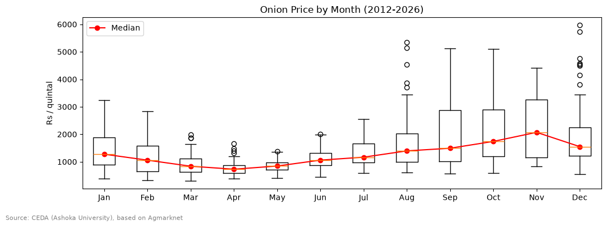
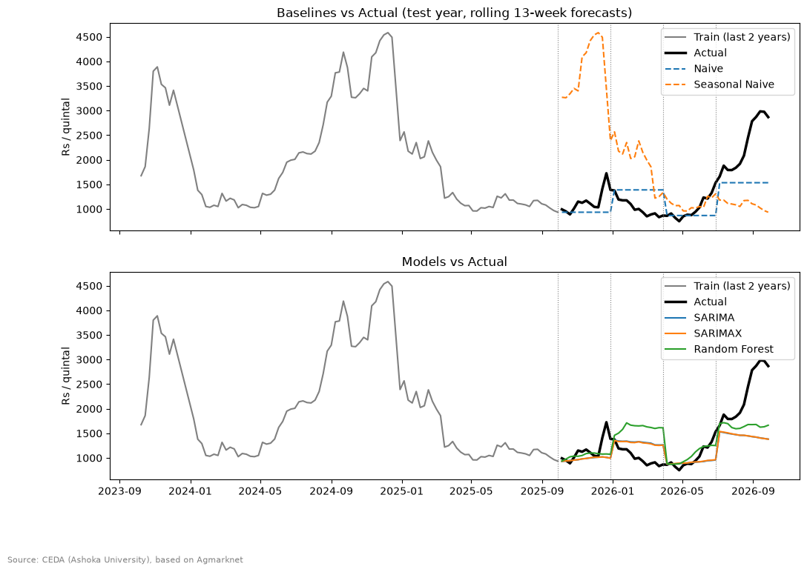
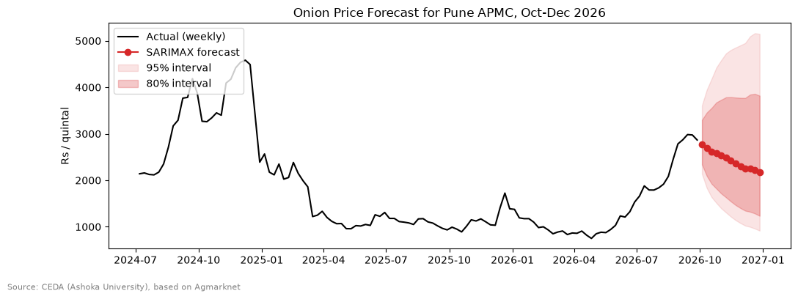

# Forecasting Onion Prices at Pune APMC

**ML Lab 10 / Mini Project:** Perform time series analysis and build a forecasting model using an appropriate dataset.

## Problem
Onion prices in India change sharply. They can triple within a few months after crop damage or a policy change.
This project analyses 14 years of daily onion prices at the **Pune APMC** (Agricultural Produce Market Committee)
and forecasts the **weekly modal price (Rs/quintal) for October–December 2026**. The forecast will then be compared with the real prices as they are published.

## Data source
* **File:** `onion_pune_mumbai_2012_2026.csv`
* **Source:** CEDA (Centre for Economic Data and Analysis), Ashoka University, compiled from **Agmarknet**, Government of India.
* 16 mandis in Pune, Thane and Mumbai, 01-Jan-2012 to 28-Sep-2026. Only `market == "Pune"` is used (4,021 trading days).
* Columns: date, district, market, commodity, min_price, max_price, **modal_price** (target), arrivals_tonnes.
* Prices are in Rs per quintal (100 kg); arrivals are in tonnes.

## Steps
1. **Load and inspect**: filter to Pune, check data types, missing values and the date range.
2. **Clean**: convert dates, check for duplicates, drop 58 days with no price, and check outliers with IQR. The extreme prices are real crises (Dec 2019, 2023–24), so they were **kept**.
3. **Resample to weekly**: mean modal price and sum of arrivals, giving 770 weeks. 18 empty weeks (COVID-2020, Dec-2023) were filled by interpolation.
4. **EDA**: trend, seasonal decomposition, monthly seasonality, price vs arrivals, ADF test, ACF/PACF.
5. **Time-based split**: train Jan-2012 to Sep-2025, test Oct-2025 to Sep-2026 (52 weeks), with no shuffling.
   Models are tested with **rolling 13-week forecasts** from 4 quarterly origins. Each uses only data available at that time, the same way the real Oct–Dec forecast is made.
6. **Models**: Naive, Seasonal Naive, SARIMA(1,0,1)(1,0,0,52) on log price, SARIMAX with log arrivals, and a lag-feature Random Forest (recursive).
7. **Evaluate** with MAE, RMSE and MAPE.
8. **Retrain the best model on all data** and forecast Oct–Dec 2026 with 80% and 95% prediction intervals.

## Key EDA findings
* Strong yearly seasonality: the median price is lowest in **April (Rs 729)** and highest in **November (Rs 2,071)**.
* There is no steady trend. Instead prices follow boom–bust cycles, with crises in 2013, 2015, 2019–20, 2023 and 2024.
* Price and arrivals are only weakly negatively correlated (r ≈ −0.22).
* The weekly price is stationary (ADF p < 0.05) and behaves like a strong AR(1) process (PACF lag 1 = 0.97).



## Results (test year Oct-2025 to Sep-2026)

| Model | MAE (Rs/q) | RMSE (Rs/q) | MAPE (%) | Beats Naive? |
|---|---|---|---|---|
| **SARIMAX** + arrivals | **365.6** | 555.4 | **22.5** | Yes (+4.9% MAE) |
| SARIMA | 368.3 | 557.0 | 22.7 | Yes (+4.2%) |
| Random Forest (lags) | 371.7 | **531.6** | 26.9 | Yes on MAE (+3.3%), no on MAPE |
| Naive | 384.3 | 541.7 | 25.2 | – |
| Seasonal Naive | 1229.0 | 1587.0 | 98.9 | No |

**Honest verdict:** SARIMAX is the best model, but it beats the naive "last week's price" forecast by only about 5%.
The arrivals variable has the expected negative sign but is **not statistically significant** (p = 0.36).
Seasonal Naive fails because 2024 was a crisis year and 2025 was not.



## Forecast: October–December 2026 (SARIMAX, trained on all data)

| Month | Forecast (Rs/quintal) | 80% interval |
|---|---|---|
| Oct 2026 | 2,668 | 2,046 – 3,496 |
| Nov 2026 | 2,418 | 1,553 – 3,771 |
| Dec 2026 | 2,227 | 1,298 – 3,823 |

Weekly values are in `forecast_oct_dec_2026.csv`. Fill in its `Actual` column as real prices come out and run the last cell of the notebook (Step 8.1) to score the forecast.



## Limitations
* **Future arrivals are unknown**, so the same week of last year was used as a stand-in. This weakens SARIMAX.
* The real drivers of onion crises (rainfall, crop damage, storage stocks, export bans or duties) are **not in the data**.
* The model is mean-reverting and **under-weights the Oct–Nov seasonal peak**, so the downward slope of the forecast should be read with caution.
* The test set covers one year with a single price surge (Jul–Sep 2026), which every model under-predicted.
* Interpolated weeks (COVID-2020, Dec-2023) are estimates.
* The price spikes are multiplicative, so the prediction intervals are wide, especially for December.

## How to run
```
pip install -r requirements.txt
```
Open `onion_price_forecasting.ipynb` and choose **Run All**. It takes about 6 minutes, because SARIMA with a 52-week season is slow to fit.

## Files
| File | Contents |
|---|---|
| `onion_price_forecasting.ipynb` | Full practical: aim, theory, code, observations, interpretation, conclusion |
| `onion_pune_mumbai_2012_2026.csv` | Raw data (CEDA / Agmarknet) |
| `forecast_oct_dec_2026.csv` | Weekly forecast with intervals and an empty `Actual` column |
| `figures/` | Charts used in this README |
| `requirements.txt` | Library versions |

*Data: CEDA, Ashoka University, based on Agmarknet (agmarknet.gov.in).*
